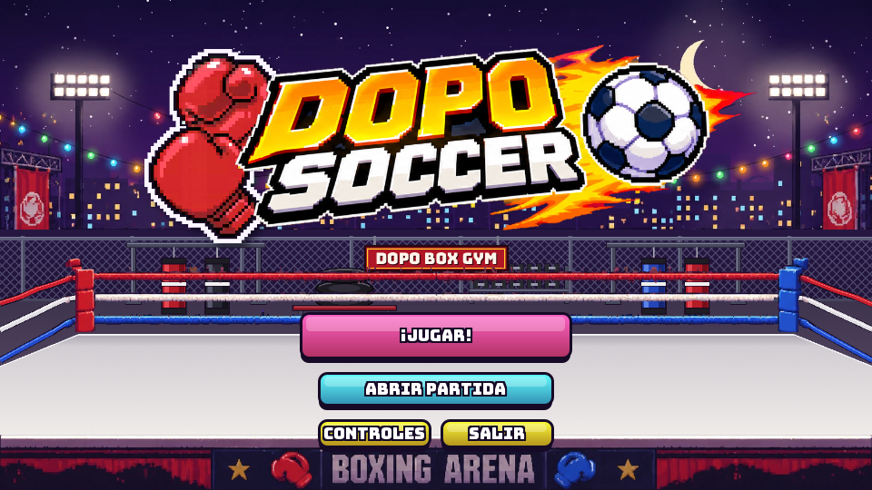
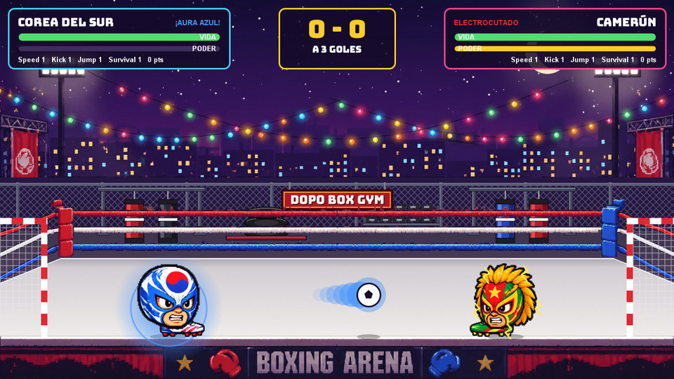
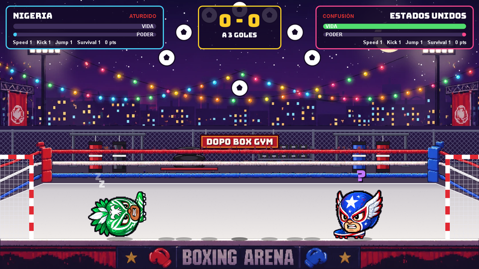

<div align="center">



# DOPOSoccer

**Fútbol 2D arcade, uno contra uno, en el mismo teclado… y en un ring de box.**

Proyecto final de *Desarrollo Orientado por Objetos* (DOPO) 2026-2 · Escuela Colombiana de Ingeniería
Una versión para computador de *Head Soccer*.


</div>

---

## ⚽ ¿De qué se trata?

Dos cabezones se enfrentan en un ring de box al aire libre. Cada jugador camina, salta, patea y carga su **tiro de poder** para meter el balón en el arco rival. Cada personaje representa a un país y tiene un poder con un efecto distinto sobre el rival: lo empuja, lo electrocuta, lo deja inconsciente o lo confunde con balones falsos.

Se juega **Jugador vs Jugador** en el mismo teclado o **Jugador vs Máquina** contra cuatro perfiles distintos. Con los puntos de cada partido, cada jugador **mejora sus estadísticas**, y su progreso se guarda entre partidas.

<div align="center">


</div>

## ✨ Características

- **Dos modalidades:** Jugador vs Jugador y Jugador vs Máquina, eligiendo el perfil de la máquina y su lado.
- **Dos tipos de partido:** por tiempo, con muerte súbita si hay empate, o por goles.
- **Cuatro personajes**, cada uno con su tiro de poder, su efecto y su aura.
- **Física arcade:** gravedad, rebotes, fricción, travesaños y choques entre jugadores.
- **Vida, daño y aturdimiento:** las patadas y los tiros de poder bajan la vida, y quien llega a cero se queda dormido 3 segundos.
- **Estadísticas mejorables:** Speed, Kick, Jump y Survival, del nivel 1 al 10. Cada mejora cuesta el doble de la anterior: 500, 1000, 2000…
- **Progreso guardado:** los puntos y las estadísticas de cada jugador se conservan entre partidos y al cerrar el juego.
- **Guardar y abrir partidas** desde la pausa y el menú.
- **Tres resoluciones de cancha:** 800×450, 1024×576 y 1280×720.

## 🥊 Personajes

| País | Tiro de poder | Efecto si golpea al rival | Duración | Daño |
|---|---|---|---|---|
| 🇰🇷 Corea del Sur | **Aura Azul**: recto y muy rápido | **Empuje:** lo lanza hacia su propio arco | 1.5 s | 40 |
| 🇨🇲 Camerún | **Rayo**: recto, cubierto de electricidad | **Electrocutado:** no salta y va al 50 % de velocidad | 3 s | 60 |
| 🇳🇬 Nigeria | **Tornado**: a ras de suelo, rebotando | **Inconsciente:** sale volando y no puede moverse, saltar ni patear | 3 s | 40 |
| 🇺🇸 Estados Unidos | **Ilusión**: el balón se divide | **Confusión:** aparecen 8 balones iguales y 7 son falsos | 2.5 s | 30 |

El daño real es `daño × multiplicador de Kick`. La barra de poder se llena en 10 segundos y sube un cuarto cuando te meten un gol.

## 🤖 Perfiles de máquina

| Perfil | Cómo juega |
|---|---|
| **Torpe** | Escoge sus movimientos al azar. |
| **Ofensiva** | Va siempre por el balón y usa el poder apenas lo tiene. |
| **Defensiva** | Cuida su arco y solo sale cuando el balón llega a su mitad. |
| **Experta** | Decide según el partido: ataca, se defiende si va ganando por dos goles o si el rival la amenaza con su poder, y guarda el poder para la mitad rival. |

## 🎮 Controles

| Acción | Jugador izquierdo | Jugador derecho |
|---|---|---|
| Moverse | `A` `D` | `←` `→` |
| Saltar | `W` | `↑` |
| Patear | `Espacio` | `K` |
| Activar poder | `S` | `↓` |

| Partido | Tecla |
|---|---|
| Pausar / seguir | `P` |
| Guardar partida (en pausa) | `G` |
| Terminar partido | `Esc` |

También están en el botón **Controles** del menú.

## 🚀 Cómo jugar

Necesitas **Java 21** o superior. Desde la carpeta del proyecto, en PowerShell:

```powershell
javac -encoding UTF-8 -d bin (Get-ChildItem -Recurse src -Filter *.java).FullName
Copy-Item src/presentation/imagenes, src/presentation/fuentes bin/presentation -Recurse -Force
java -cp bin presentation.DOPOSoccerGUI
```

La segunda línea copia las imágenes y la fuente junto a las clases compiladas; sin ellas, el juego se abre sin fondos.

## 🧪 Pruebas

El dominio tiene **230 pruebas unitarias** con JUnit 6. Descarga [`junit-platform-console-standalone-6.1.3.jar`](https://central.sonatype.com/artifact/org.junit.platform/junit-platform-console-standalone) en la carpeta `lib/` y corre:

```powershell
javac -encoding UTF-8 -d bin -cp lib/junit-platform-console-standalone-6.1.3.jar (Get-ChildItem -Recurse src,test -Filter *.java).FullName
java -jar lib/junit-platform-console-standalone-6.1.3.jar execute -cp bin --scan-classpath
```

## 🏗️ Diseño

El proyecto está separado en dos capas que solo se hablan a través de la fachada `DOPOSoccer`:

```
src/
├── domain/         reglas del juego: partido, jugadores, balón, poderes, efectos y máquinas
└── presentation/   interfaz en Swing: pantallas, vistas, controles e imágenes
test/
└── domain/         pruebas unitarias del dominio
docs/               planificación, retrospectivas y capturas
DOPOSoccer.asta     diagramas de clases y de secuencia (Astah UML)
```

Patrones de diseño que usamos:

| Patrón | Dónde |
|---|---|
| **Facade** | `DOPOSoccer`, la única puerta entre la interfaz y el dominio |
| **Factory Method** | `Catalogo` crea personajes, máquinas y tipos de partido por su nombre |
| **Strategy** | tiros (`Tiro`), fricción (`Friccion`) y controladores (`Controlador`) |
| **State** + **Null Object** | efectos de los poderes (`Efecto`, `SinEfecto`) |
| **Template Method** | perfiles de máquina (`Maquina`) |
| **Composite** | vistas de la pantalla de juego (`Vista`, `VistaCompuesta`) |
| **Builder** | configuración del partido (`ConfiguracionPartido`) |

Agregar un personaje, un efecto o un perfil de máquina nuevo es crear una clase y registrarla con una línea en el `Catalogo`.

## 📄 Documentación

- [Planificación de las versiones](docs/Planificacion-Versiones.pdf) ([fuente LaTeX](docs/Planificacion-Versiones.tex))
- [Retrospectiva de la Versión uno](docs/Retrospectiva-Version-Uno.pdf)
- [Retrospectiva de las Versiones dos y tres](docs/Retrospectiva-Versiones-Dos-y-Tres.pdf)
- Diagramas de clases y de secuencia en [`DOPOSoccer.asta`](DOPOSoccer.asta)

## 👥 Equipo

- **Juan Diego Castaño Parra**
- **Juan Diego Carreño Gutierrez**

<div align="center">
<sub>Basado en <i>Head Soccer</i> (D&amp;D Dream, 2012). Proyecto académico sin fines comerciales.</sub>
</div>
